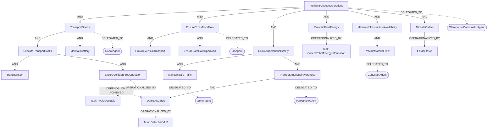

# WareTwin DT → Goal Graph mapping

Ánh xạ Thing trên Eclipse Ditto với goal knowledge graph trong Neo4j.

Robot dùng cây goal đơn giản với `clause`, `depends_on` và `parameter_dependency`, xem
[Robot goal model](../docs/waretwin-robot-goal-model.md). Loader `seed_neo4j.py`
nạp contract từ `goal_model/waretwin_robot.json` sau topology Cypher.

Bridge WareTwin hiện ghi `attributes.goalRootId` và `attributes.goalAgentId` cùng
một **Goal ID** theo bảng bên dưới. Tên `goalAgentId` được giữ để tương thích;
đợt đổi ID này chưa chuyển giá trị sang `A_*` hoặc thay đổi uniqueness của Ambassador.
UI cũng hỗ trợ Agent ID bằng cách tìm goal qua `DELEGATED_TO`.

Robot và Lift dùng scope được giao cho Agent (`G_WT_TRANSPORT`, `G_WT_CROSSFLOOR`).
`G_R_EXECUTE_TRANSPORT` và `G_LT_PROVIDE_VERTICAL_TRANSPORT` là goal trung gian,
không phải toàn bộ phạm vi trách nhiệm. `G_WT_ALLOC` không có phân công trực tiếp,
nhưng kế thừa trách nhiệm của WarehouseCoordinatorAgent và operationalize order tasks.

Các Thing cùng nhóm dùng chung goal. Bridge ghi qua MQTT/Ditto; không dùng API
create-only của Ambassador để đăng ký nhiều Thing trùng `goalAgentId`.
Migration: [đổi Goal ID và mapping](README_Goal_ID_Migration.md).

## Agents & Thing

| Agent (Neo4j) | Ditto thingId(s) | root Goal | Số Thing |
|---|---|---|---|
| `A_WARETWIN` (WarehouseCoordinatorAgent) | `waretwin:warehouse` (+ `task-*` qua `taskThingPattern`) | `G_WT_FULFILL_OPERATIONS` | 1 |
| `A_ROBOT` (RobotAgent) | `waretwin:robot-R01` … `R20` | `G_WT_TRANSPORT` | 20 |
| `A_LIFT` (LiftAgent) | `waretwin:lift-LIFT-1`, `LIFT-2` | `G_WT_CROSSFLOOR` | 2 |
| `A_CONVEYOR` (ConveyorAgent) | `waretwin:conveyor-CV01` … `CV04` | `G_CV_PROVIDE_MATERIAL_FLOW` | 4 |
| `A_ZONE` (ZoneAgent) | `waretwin:zone-A` … `zone-D`, `waretwin:zone-M` | `G_Z_MAINTAIN_SAFE_TRAFFIC` | 5 |
| `A_PERCEPTION` (PerceptionAgent) | `waretwin:camera-*`, `waretwin:sensor-*` | `G_P_PROVIDE_SITUATIONAL_AWARENESS` | 22 |

Trong KG, các đơn hàng động `waretwin:task-*` thuộc phạm vi `taskThingPattern` của
`A_WARETWIN`, được xử lý qua goal `G_WT_ALLOC` và bốn order task. Không có Agent riêng
cho mỗi đơn hàng; bridge gán hai thuộc tính goal của task Thing bằng `G_WT_ALLOC`.

## Goal tree tóm tắt

| Root | Nhánh chính | Task tiêu biểu |
|---|---|---|
| `G_WT_FULFILL_OPERATIONS` | TransportGoods / EnsureCrossFloorFlow / EnsureOperationalSafety / MaintainFleetEnergy / MaintainInfrastructureAvailability / AllocateOrders | `T_ORDER_PICK/TRANSPORT/REPLENISH/RETURN` |
| `G_WT_TRANSPORT` | ExecuteTransportTasks (TransportItem, CollisionFree) · MaintainBattery (Reach/Recharge) | `T_R_NAVIGATE/PICK/DROP/CHARGE/RECHARGE/AVOID` |
| `G_WT_CROSSFLOOR` | ProvideVerticalTransport (Serve: Queue/Move, Recover) · EnsureSafeGateOperation | `T_LIFT_QUEUE/GATE/SERVE/RECOVER` |
| `G_WT_ENERGY` | Thu thập thông tin năng lượng đội robot | `T_FLEET_COLLECT_ENERGY` |
| `G_CV_PROVIDE_MATERIAL_FLOW` | TransportItemsOnBelt · FeedStations · ReportFailure | `T_BELT_RUN/FEED/STOP` |
| `G_Z_MAINTAIN_SAFE_TRAFFIC` | MonitorCongestion · BlockOnHazard | `T_ZONE_MONITOR/BLOCK` |
| `G_P_PROVIDE_SITUATIONAL_AWARENESS` | DetectHazards · ReportTelemetry | `T_VLM_DETECT/SENSOR_REPORT` |

## Quan hệ và trách nhiệm

| Quan hệ | Từ → Đến | Ghi chú |
|---|---|---|
| `REFINES {type: AND\|OR}` | Goal → Goal | Phân rã từ cấp kho tới cây thành phần và goal lá |
| `DELEGATED_TO` | Goal gốc → Agent | Robot, Lift, Conveyor mỗi agent chỉ nhận một goal gốc |
| `OPERATIONALIZED_BY` | Goal lá → Task | Task là cấp thực thi thấp nhất |
| `DEPENDS_ON {type: ACHIEVED}` | Goal → Goal | Điều kiện phối hợp, không thay thế phân rã |
| `DEPENDS_ON {type: PARAMETER}` | Task → Task | Truyền tham số; Recharge → ReachCharger được biểu diễn ở mức Goal |

Goal con kế thừa trách nhiệm từ goal gốc của model. Không nối mọi goal con trực tiếp
vào Agent. Khi tìm agent của một goal, chọn tổ tiên được `DELEGATED_TO` gần nhất
(theo số cạnh `REFINES`), không yêu cầu tổ tiên đó không có cha: root thành phần
hiện nằm dưới goal cấp kho.

## Cây goal từ cấp kho



Sơ đồ trên lược bớt các goal con và task thành phần; chi tiết ba model ở dưới.
`MaintainBattery` (`G_R_ENERGY`) chỉ nằm trực tiếp dưới `TransportGoods`, ngang hàng
với `ExecuteTransportTasks`. `MaintainFleetEnergy` không còn phân rã thành goal con;
chỉ có một task `CollectRobotEnergyInformation` qua `OPERATIONALIZED_BY`.
Task mới được khai báo trong KG; handler thu thập telemetry không nằm trong các seed này.

`ExecuteTransportTasks` yêu cầu cả `TransportItem` và `EnsureCollisionFreeOperation`
qua phân rã AND. Robot chịu trách nhiệm tránh, dừng hoặc nhường đường; Perception
chịu trách nhiệm phát hiện nguy hiểm. `G_R_SAFE → DEPENDS_ON {type: ACHIEVED} → G_P_DETECT`
biểu diễn sự phối hợp này mà không thay đổi phân công hay cây goal của Perception.
Cạnh phụ thuộc được hiển thị riêng trong sơ đồ tổng quan; truy vấn hierarchy phía dưới
vẫn chỉ lấy phân rã, phân công và task, không mở rộng `DEPENDS_ON`.

| Goal cấp kho | Phân rã `REFINES AND` tới |
|---|---|
| `G_WT_TRANSPORT` | `G_R_EXECUTE_TRANSPORT`, `G_R_ENERGY` |
| `G_WT_CROSSFLOOR` | `G_LT_PROVIDE_VERTICAL_TRANSPORT`, `G_LT_GATE` |
| `G_WT_INFRA` | `G_CV_PROVIDE_MATERIAL_FLOW` |
| `G_WT_SAFETY` | `G_Z_MAINTAIN_SAFE_TRAFFIC`, `G_P_PROVIDE_SITUATIONAL_AWARENESS` — giữ cấu trúc đang có trên Neo4j |

Chỉ `G_WT_TRANSPORT`, `G_WT_CROSSFLOOR`, `G_CV_PROVIDE_MATERIAL_FLOW` lần lượt giao trực tiếp cho
`A_ROBOT`, `A_LIFT`, `A_CONVEYOR`. RobotAgent phụ trách cả vận chuyển và duy trì pin.
LiftAgent chịu trách nhiệm toàn bộ nhánh liên tầng;
`ProvideVerticalTransport` và `EnsureSafeGateOperation` không có phân công trực tiếp. `G_WT_ALLOC` vẫn không gán agent và nối tới bốn order task.
Nhánh Safety giữ nguyên goal, phân công, task và quan hệ hiện có.

## Phân cấp thành phần tới task

Trong sơ đồ chữ này, Goal → Goal là `REFINES`; Goal → Task là `OPERATIONALIZED_BY`.
Nhãn AND/OR sau goal cha áp dụng cho các goal con của nó.

```text
TransportGoods [RobotAgent, AND]
├── ExecuteTransportTasks [AND]
│   ├── TransportItem [AND]
│   │   ├── NavigateToTarget → Task: Navigate
│   │   ├── PickLoad → Task: Pick
│   │   └── DeliverLoad → Task: Drop
│   └── EnsureCollisionFreeOperation → Task: AvoidObstacle
└── MaintainBattery [AND]
    ├── ReachCharger → Task: GoToCharger
    └── RechargeBattery → Task: Recharge

MaintainFleetEnergy → Task: CollectRobotEnergyInformation

EnsureCrossFloorFlow [LiftAgent, AND]
├── ProvideVerticalTransport [OR]
│   ├── ServeTransportRequest [AND]
│   │   ├── QueueAndReserve → Task: QueueForService
│   │   └── MoveBetweenFloors → Task: Serve
│   └── RecoverFromFault → Task: Recover
└── EnsureSafeGateOperation → Task: ControlGate

ProvideMaterialFlow [ConveyorAgent, AND]
├── TransportItemsOnBelt → Task: RunBelt
├── FeedStations → Task: FeedStation
└── ReportFailure → Task: StopBelt
```

## Truy vấn graph có task

Trong Neo4j Browser, chạy riêng `:param rootGoalId => 'G_WT_FULFILL_OPERATIONS'` để xem toàn kho.
Thay root theo bảng để xem một model; các truy vấn chỉ đi theo hướng cha → con,
không đi ngược từ Agent sang các goal khác và không mở rộng `DEPENDS_ON`.

| Model | Root Goal ID | Goal / Agent / Task phân biệt |
|---|---|---|
| Toàn kho | `G_WT_FULFILL_OPERATIONS` | 32 / 6 / 22 |
| Robot | `G_WT_TRANSPORT` | 10 / 1 / 6 |
| Lift | `G_WT_CROSSFLOOR` | 7 / 1 / 4 |
| Conveyor | `G_CV_PROVIDE_MATERIAL_FLOW` | 4 / 1 / 3 |
| Zone | `G_Z_MAINTAIN_SAFE_TRAFFIC` | 3 / 1 / 2 |
| Perception | `G_P_PROVIDE_SITUATIONAL_AWARENESS` | 3 / 1 / 2 |

```cypher
MATCH path = (:Goal {id: $rootGoalId})-[:REFINES*0..]->(goal:Goal)
OPTIONAL MATCH assignment = (goal)-[:DELEGATED_TO]->(:Agent)
OPTIONAL MATCH execution = (goal)-[:OPERATIONALIZED_BY]->(:Task)
RETURN path, assignment, execution;
```

Để tra cứu các phụ thuộc phối hợp còn lại:

```cypher
MATCH (:Goal {id: $rootGoalId})-[:REFINES*0..]->(goal:Goal)
MATCH dependency = (goal)-[:DEPENDS_ON]->(:Goal)
RETURN DISTINCT dependency;
```

Các truy vấn là hướng dẫn xem graph trong Neo4j Browser; không tự thay đổi UI ứng dụng.

## Kiểm tra sau khi seed

Mỗi agent sau phải có đúng một goal trực tiếp, tương ứng bảng root ở đầu tài liệu:

```cypher
MATCH (agent:Agent)
WHERE agent.id IN ['A_ROBOT', 'A_LIFT', 'A_CONVEYOR']
OPTIONAL MATCH (goal:Goal)-[:DELEGATED_TO]->(agent)
RETURN agent.id AS agentId, collect(goal.id) AS assignedGoals;
```

Mọi goal lá trong toàn kho phải có task; truy vấn sau phải trả **0 dòng**:

```cypher
MATCH (:Goal {id:'G_WT_FULFILL_OPERATIONS'})-[:REFINES*0..]->(goal:Goal)
WHERE NOT (goal)-[:REFINES]->(:Goal)
  AND NOT (goal)-[:OPERATIONALIZED_BY]->(:Task)
RETURN DISTINCT goal.id AS leafWithoutTask;
```

Seed theo thứ tự component → system → integration. Các seed có xóa cạnh giao trực tiếp
cũ trong ba model và ở cấp kho; integration bỏ bốn cạnh `DEPENDS_ON ACHIEVED` cũ.
Seed Robot chuyển nhánh pin khỏi `ExecuteTransportTasks`; system nối nhánh này
vào `TransportGoods`, giao goal này cho RobotAgent và operationalize FleetEnergy
bằng task thu thập thông tin. Seed Lift bỏ cạnh cũ `G_LT_SERVE → G_LT_GATE` và
phân công cũ ở `G_LT_PROVIDE_VERTICAL_TRANSPORT`; seed system nối hai goal con trực tiếp và giao
`G_WT_CROSSFLOOR` cho `A_LIFT`. Không xóa node hoặc task. Chạy lại không được thay đổi graph.
Khi cập nhật graph đang có, chụp snapshot và đối chiếu toàn bộ nhánh Safety trước/sau.

## Nguồn dữ liệu

- Các file `waretwin_*_kg.md` và `waretwin_integration_relations.md` là Cypher thuần,
  được `seed_neo4j.py` nạp. File mapping này chỉ là tài liệu, không được seed.
- Các Agent ID, Root Goal ID và nhóm Thing trong bảng được đối chiếu với seed tại repo này.
- Nguồn bridge đã đối chiếu: repo WareTwin, `backend/app/mqtt.py`, các hằng
  `SECTION_GOAL_ROOT` và `WAREHOUSE_GOAL_ROOT`. Test `backend/tests/test_mqtt.py`
  kiểm tra mapping và payload sau reset/restart publisher.
