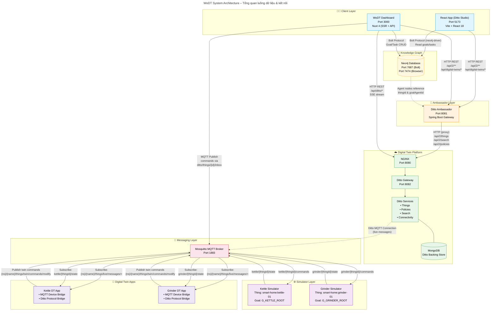

# Kiến trúc Hệ thống WoDT (Web of Digital Twins)



## Chú thích luồng dữ liệu chính

### 1. Luồng tạo Digital Twin
```
React App → PUT /api/digital-twins/{thingId} (Ambassador)
         → Kiểm tra goalAgentId uniqueness (Ditto Search)
         → PUT /api/2/things/{thingId} (Ditto)
         → Tạo Agent node trong Neo4j
```

### 2. Luồng gửi lệnh (qua WoDT)
```
Nuxt Dashboard → POST /api/digital-twin/things/{id}/tasks/{taskId}/execute
              → Tra cứu task trong Neo4j → map device command
              → Publish MQTT tới ditto/things/{thingId}/inbox/messages/direct-web
              → Ditto forward live message → DT App nhận được
              → DT App publish tới kettle/grinder/{thingId}/commands
              → Simulator xử lý → publish state ngược lại
```

### 3. Luồng cập nhật trạng thái real-time
```
Simulator → publish state → MQTT (kettle/{thingId}/state)
         → DT App (subscribed) nhận state
         → DT App publish lên Ditto qua twin commands
         → Ditto cập nhật twin state
         → Nuxt SSE stream / client polling đọc được
```

### 4. Luồng Orchestration (System Goal - MakeCoffee)
```
Nuxt → GET /api/system/actions → đọc goal tree từ Neo4j
     → Giải quyết dependency giữa các goals (HotWaterAvailable → G_K1)
     → Map goals → things (DELEGATED_TO)
     → Giải quyết parameter dependency (beanAmount → waterVolume * 5.0)
     → Thực thi tasks theo thứ tự ưu tiên
```

## Bảng cổng kết nối

| Cổng    | Service               | Giao thức |
|---------|-----------------------|-----------|
| 8080    | Eclipse Ditto (HTTP)  | REST/HTTP |
| 8081    | Ditto Ambassador      | REST/HTTP |
| 1883    | Mosquitto MQTT        | MQTT      |
| 5173    | React App (Vite)      | HTTP      |
| 3000    | WoDT Nuxt App         | HTTP      |
| 7687    | Neo4j Bolt            | Bolt      |
| 7474    | Neo4j Browser         | HTTP      |